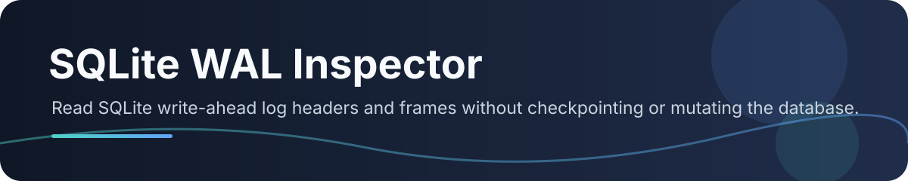

<p align="center"></p>

# SQLite WAL Inspector ✨

> Read SQLite write-ahead log headers and frames without checkpointing or mutating the database.

[](https://github.com/MofidChallenge10/sqlite-wal-inspector/actions/workflows/ci.yml) [](LICENSE) 

## 🎯 Why this project?

Read SQLite write-ahead log headers and frames without checkpointing or mutating the database. It focuses on a narrow operational problem and keeps its output inspectable, deterministic, and suitable for scripts or CI.

## 🚀 Features

- 🧭 Solves the documented use case without a hosted service.
- 🧪 Includes repeatable tests and a runnable example.
- 📄 Supports concise human-readable output; machine-readable output is available where documented.
- 🔒 Avoids changing the target system during inspection.

## ⚡ Quick Start

```bash
python -m pip install -e .
python -m sqlite_wal_inspector ./app.db
```

## 🖥️ Example

```text
WAL: app.db-wal
Page size: 4096
Frames: 12
Committed transactions: 3
Last commit frame: 12
Truncated tail: no
```

## 🗺️ Roadmap

- Verify WAL rolling checksums in addition to salts and frame boundaries.
- Add optional JSON export for database observability agents.
- Add fixtures from multiple SQLite versions.

## 🤝 Contributing

See [CONTRIBUTING.md](CONTRIBUTING.md). Bug reports should include the command, a minimal input fixture, and the observed output. Please do not attach credentials or private production data.

## 📜 License

MIT — see [LICENSE](LICENSE).
